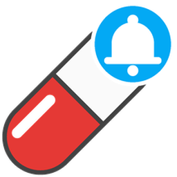

# Pill Reminder

[](https://hacs.xyz/docs/faq/custom_repositories)
[](https://github.com/GuidoJeuken-6512/pill-reminder/releases/latest)
[](https://github.com/GuidoJeuken-6512/pill-reminder/releases)

[](https://github.com/GuidoJeuken-6512/pill-reminder/stargazers)
[](LICENSE)
[](https://github.com/GuidoJeuken-6512/pill-reminder/actions/workflows/validate.yaml)

Home Assistant integration that reminds people to take their medication and to enter their **weight**, **waist circumference** and **blood pressure**. It logs every intake (or missed intake), keeps the measurements and shows adherence, **BMI**, **waist-to-height ratio**, **blood pressure class** and the **trend** – one app, one dashboard.

📖 **[User guide](docs/user-guide.md)** – setup, every setting, the life of a dose, body measurements, dashboard, entities, actions, automation examples, troubleshooting.

## Features

### Medication

- **Several people** (one integration entry each), **several medications** per person, **several intake times** per medication, selectable weekdays.
- **Phone notifications** (Companion App) with **Taken** and **Later** buttons. Repeated reminders replace the previous one; once confirmed, the notification disappears from all phones.
- **Repeat + escalation** (configurable): interval, maximum number of reminders, notify another person after N reminders, message when a dose was missed.
- **Manage medication in the dashboard**: add, change times/weekdays/dosage/confirmation window, pause, delete – no admin rights needed.
- **Taken button** per medication: confirms the current dose (also up to X minutes early). Plus **Later** and **Skip** (skipped on purpose, not counted as missed).
- **Pause** per medication (e.g. hospital stay, holiday) – logged as "paused".
- **Tracking**: every dose is stored with scheduled time, actual time, number of reminders, escalation and source (button / notification / service). Restarts lose nothing: doses that passed while Home Assistant was down are logged as missed, running reminders continue.
- **Evaluation**: adherence over 7/30 days (long-term statistics), streak, daily counters, last/next dose, calendar (✅ taken / ❌ missed with delay and details), logbook, `get_history` and `export_history` (CSV) actions.

### Body measurements

- **Weight**, **waist circumference** and **blood pressure** (systolic, diastolic, pulse) per person, entered in the dashboard and stored with a **Save** button (works in the Companion App too), or from a smart scale / blood pressure monitor via an action. New persons track weight and waist right away; blood pressure and the others are switched on or off in the dashboard (**Manage** tab), stored values are kept.
- **Reminder per measurement**: weight daily, waist on Mondays, each at 07:00 by default. Time, weekdays and on/off can be changed in the dashboard. One repeat after 2 hours if nothing was entered; tapping the notification opens the dashboard.
- **Evaluation**: BMI with WHO class, waist-to-height ratio with class, blood pressure class (ESC/ESH) and 7-day averages, change over 7 and 30 days, trend per week (rising / falling / stable), 90-day graphs from the long-term statistics.

### Both

- **Dashboard created automatically** ("Health" in the sidebar): per person a **medication** tab, a **body** tab and a **manage** tab, visible **only to this person and administrators**. Always up to date, nothing to maintain by hand.
- Translations: English, German.

## Installation

**HACS** (recommended):

[](https://my.home-assistant.io/redirect/hacs_repository/?owner=GuidoJeuken-6512&repository=pill-reminder&category=integration)

or manually: HACS → ⋮ → Custom repositories → add `https://github.com/GuidoJeuken-6512/pill-reminder` (type "Integration"), install "Pill Reminder", restart Home Assistant.
**Manual**: copy `custom_components/pill_reminder` to `/config/custom_components/`, restart Home Assistant.

Requires Home Assistant 2026.8 or newer.

## Setup

1. **Settings → Devices & services → Add integration → "Pill Reminder"**
   Enter the name, the Home Assistant user (who sees the views in the dashboard), the phones (`notify.mobile_app_…`), whether to track weight and waist, and the height (for BMI).
2. Add medications – either in the dashboard (**Manage** tab) or via **Add medication** on the person's integration entry: name, dosage, intake times (e.g. 08:00, 20:00), weekdays, how early a dose may be confirmed and after how many minutes it counts as missed.
3. **Configure** (gear icon) for repeat interval, snooze duration, escalation, history retention and the repeat of measurement reminders.
4. Done: **Health** appears in the sidebar (`/pill-reminder`). Enter today's weight in the **Body** tab.

Measurements are switched on or off in the **Manage** tab (`switch.anna_track_weight`, `…_track_waist_circumference`, `…_track_blood_pressure`); switching off keeps the stored values. **Add measurement** on the integration entry works too.

Input formats in the dashboard: times `08:00, 20:00` · weekdays `daily`, `Mon-Fri` or `Mon, Wed, Fri` (German also works: `täglich`, `Mo-Fr`).

The dashboard is generated by the integration and therefore cannot be edited in the dashboard editor. To build your own, start from the examples in [dashboards/](dashboards/) (standard cards only, or with Mushroom/ApexCharts).

## Entities

Examples for a person "Anna" with the medication "Ramipril" (Home Assistant language English):

| Entity | Meaning |
|---|---|
| `button.ramipril_taken` | Confirm the current dose |
| `button.ramipril_snooze` | Postpone the reminder |
| `button.ramipril_skip` | Skip the dose on purpose |
| `binary_sensor.ramipril_due` | On while a dose waits for confirmation |
| `sensor.ramipril_status` | scheduled / due / snoozed / taken / missed / skipped / paused |
| `sensor.ramipril_next_dose`, `sensor.ramipril_last_taken` | Timestamps |
| `sensor.ramipril_adherence_7_days`, `…_30_days` | taken / (taken + missed) in % |
| `sensor.ramipril_streak` | Days in a row without a missed dose |
| `switch.ramipril_reminders` | Pause reminders |
| `binary_sensor.anna_medication_due` | Any medication of the person is due |
| `sensor.anna_open_today`, `_taken_today`, `_missed_today`, `_skipped_today` | Daily counters (reset at midnight) |
| `sensor.anna_adherence_7_days`, `_30_days`, `sensor.anna_streak` | Summary per person |
| `calendar.anna_medication` | All doses as calendar events (dosage, time taken, delay, reminders, source) |

Settings per medication (used by the **Manage medication** tab): `text.ramipril_name`, `text.ramipril_intake_times`, `text.ramipril_weekdays`, `text.ramipril_dosage`, `number.ramipril_confirm_early_minutes_before`, `number.ramipril_missed_after_minutes`, `button.ramipril_delete_medication`. Per person: `text.anna_new_medication_name` / `_times` / `_dosage` and `button.anna_add_medication`.

Body measurements (person "Anna", tracks weight and waist):

| Entity | Meaning |
|---|---|
| `number.anna_weight_enter`, `number.anna_waist_enter` | Input field (shows the last value) |
| `button.anna_weight_save`, `button.anna_waist_save` | Store the input with the current time |
| `sensor.anna_weight`, `sensor.anna_waist` | Last value (long-term statistics) |
| `sensor.anna_weight_measured` | Time of the last value |
| `sensor.anna_weight_change_7_days`, `…_change_30_days` | Change compared to 7 / 30 days ago |
| `sensor.anna_weight_trend`, `sensor.anna_weight_trend_direction` | Trend in kg per week; rising / falling / stable |
| `binary_sensor.anna_weight_due` | On while today's value is missing after the reminder time |
| `switch.anna_weight_reminder`, `time.anna_weight_reminder_time`, `text.anna_weight_reminder_weekdays` | Reminder settings |
| `number.anna_height` | Height in cm |
| `sensor.anna_bmi`, `sensor.anna_bmi_category` | BMI and WHO class |
| `sensor.anna_waist_to_height_ratio`, `sensor.anna_waist_to_height_category` | Waist-to-height ratio and class |
| `number.anna_blood_pressure_systolic`, `…_diastolic`, `…_pulse`, `button.anna_blood_pressure_save` | Blood pressure input (pulse optional) |
| `sensor.anna_blood_pressure` | Last reading, e.g. `128/82` |
| `sensor.anna_blood_pressure_category` | optimal / normal / high normal / hypertension grade 1–3 |
| `sensor.anna_blood_pressure_systolic`, `…_diastolic`, `…_pulse` | Last values (long-term statistics) |
| `sensor.anna_blood_pressure_systolic_7_day_average`, … | 7-day averages |

Medication entities carry the attributes `person` and `medication`; the **Taken** button additionally has `due` (due right now) and `actionable` (may be confirmed now). Use them to filter in your own dashboards independent of language and entity ids (e.g. with auto-entities).

## Events (for your own automations)

`pill_reminder_dose_due`, `…_reminder_sent`, `…_dose_snoozed`, `…_escalated`, `…_dose_taken`, `…_dose_missed`, `…_dose_skipped` – each with `person`, `medication`, `scheduled`, `status`, `source`, `reminders_sent`.

`pill_reminder_measurement_added` (`person`, `metric`, `values`, `units`, `measured_at`, `source`; for weight and waist also `value` and `unit`) and `pill_reminder_measurement_reminder_sent` (`person`, `metric`, `count`).

## Actions

| Action | Purpose |
|---|---|
| `pill_reminder.mark_taken` | Confirm a dose; with `taken_at` also afterwards (corrects "missed") |
| `pill_reminder.snooze` | Postpone the reminder (`minutes` optional) |
| `pill_reminder.skip` | Skip the dose |
| `pill_reminder.get_history` | History as response data (filter: person, medication, period, status) |
| `pill_reminder.export_history` | History as CSV in `/config/pill_reminder/` |
| `pill_reminder.add_measurement` | Add a value: `metric` (`weight`/`waist`) with `value`, or `blood_pressure` with `systolic`, `diastolic`, optional `pulse`; optional `measured_at` for older values |
| `pill_reminder.delete_measurement` | Delete all values of a `date`, or the most recent one |
| `pill_reminder.get_measurements` | Measurements as response data |
| `pill_reminder.export_measurements` | Measurements as CSV in `/config/pill_reminder/` |

## Development

```powershell
# Tests (isolated container)
docker run -d --name tw-test -v "${PWD}:/work" -w /work python:3.14-slim sleep infinity
docker exec tw-test pip install -r requirements_test.txt
docker exec tw-test python -m pytest -q
docker exec tw-test ruff check custom_components tests

# Copy into a local Home Assistant test container and restart it
powershell -ExecutionPolicy Bypass -File scripts\deploy.ps1
```

**Note:** This is a reminder aid, not a medical device. BMI, waist-to-height ratio and blood pressure classes are general reference values for adults. Nothing here replaces medical advice.
