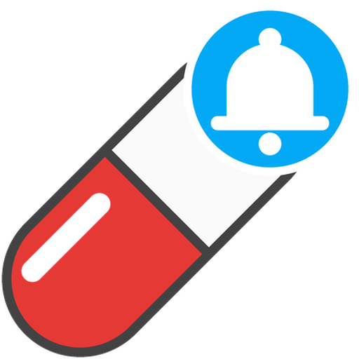
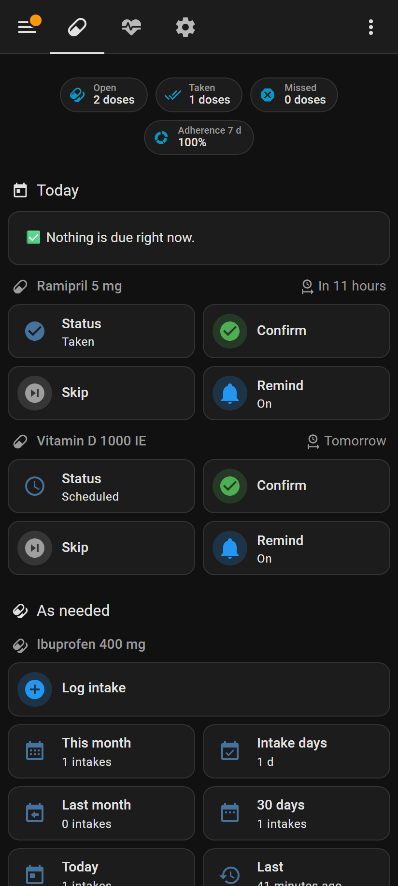
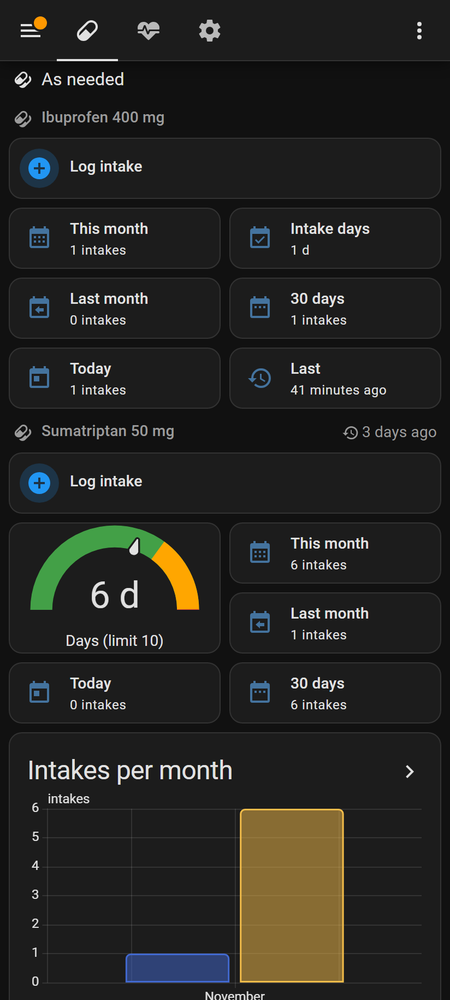
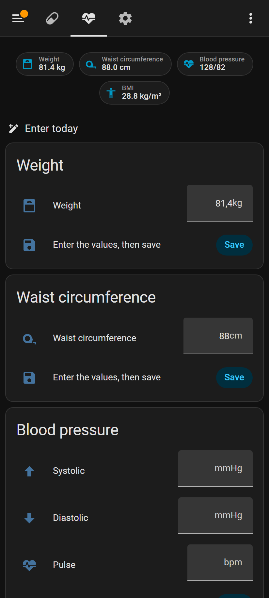
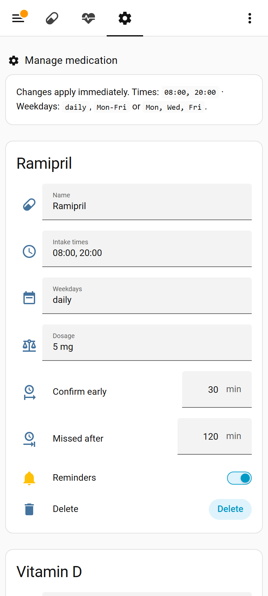
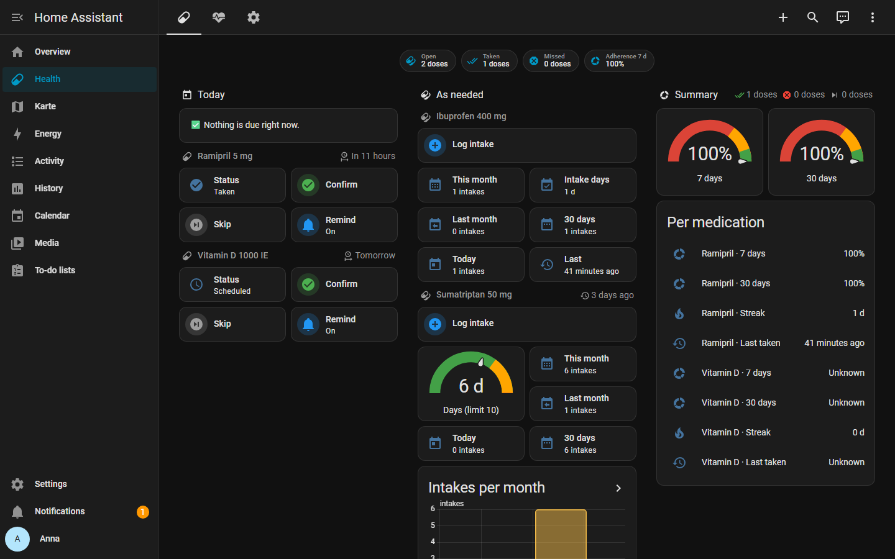

# Health Tracker

**Health Tracker** (formerly *Pill Reminder*) is a Home Assistant integration that reminds the people in your household to take their medication, counts how often on-demand medication such as migraine tablets is taken, and records **weight**, **waist circumference** and **blood pressure**. One integration, one dashboard, everything stays in your Home Assistant.

[Get started](#quick-start){ .md-button .md-button--primary }
[User guide](user-guide.md){ .md-button }

-   :material-pill:{ .lg .middle } **Medication reminders**

    ---

    Several intake times and weekdays per medication. Phone notifications with **Taken** and **Later**, repeats, escalation to another person, a log of every dose and the adherence over 7 and 30 days.

    [:octicons-arrow-right-24: Adding medications](user-guide.md#4-adding-medications)

-   :material-pill-multiple:{ .lg .middle } **On-demand medication**

    ---

    For medication taken as needed, e.g. for migraine: a **Log intake** button, the intakes per day and month, the intake days and an optional monthly limit with a warning.

    [:octicons-arrow-right-24: On-demand medication](user-guide.md#on-demand-medication-as-needed)

-   :material-heart-pulse:{ .lg .middle } **Body measurements**

    ---

    Weight, waist and blood pressure with reminders, BMI, waist-to-height ratio, blood pressure class (ESC/ESH), 7-day averages and trends.

    [:octicons-arrow-right-24: Body measurements](user-guide.md#7-body-measurements)

-   :material-view-dashboard:{ .lg .middle } **Dashboard for phones**

    ---

    Created automatically, always up to date, visible only to the person and administrators. Built from Home Assistant's own cards and laid out for phones.

    [:octicons-arrow-right-24: The dashboard](user-guide.md#9-the-dashboard)

## Screenshots

{ loading=lazy }

{ loading=lazy }

{ loading=lazy }

{ loading=lazy }

On a large screen the same sections sit side by side:

{ loading=lazy }

## Quick start

1. **Install** with HACS: Health Tracker is in the HACS default store. Search for **Health Tracker**, install it and restart Home Assistant. Requires Home Assistant 2026.8 or newer.

    

2. **Add a person**: *Settings → Devices & services → Add integration → Health Tracker*. Enter the name, the Home Assistant user and the phones (`notify.mobile_app_…`).
3. **Add medications** in the dashboard (**Manage** tab) or on the integration entry: scheduled medication with intake times, or on-demand medication with optional limits.
4. Open **Health** in the sidebar.

Details for every step and setting are in the [user guide](user-guide.md).

!!! note "Not a medical device"

    Health Tracker is a reminder aid. BMI, waist-to-height ratio, blood pressure classes and intake limits are general reference values, not a diagnosis. Always keep a second way of remembering important medication.

## Help and feedback

- [Questions and bug reports](https://github.com/GuidoJeuken-6512/pill-reminder/issues) on GitHub
- [Changelog](changelog.md) – what changed in each release
- [Troubleshooting](user-guide.md#15-troubleshooting) in the user guide
